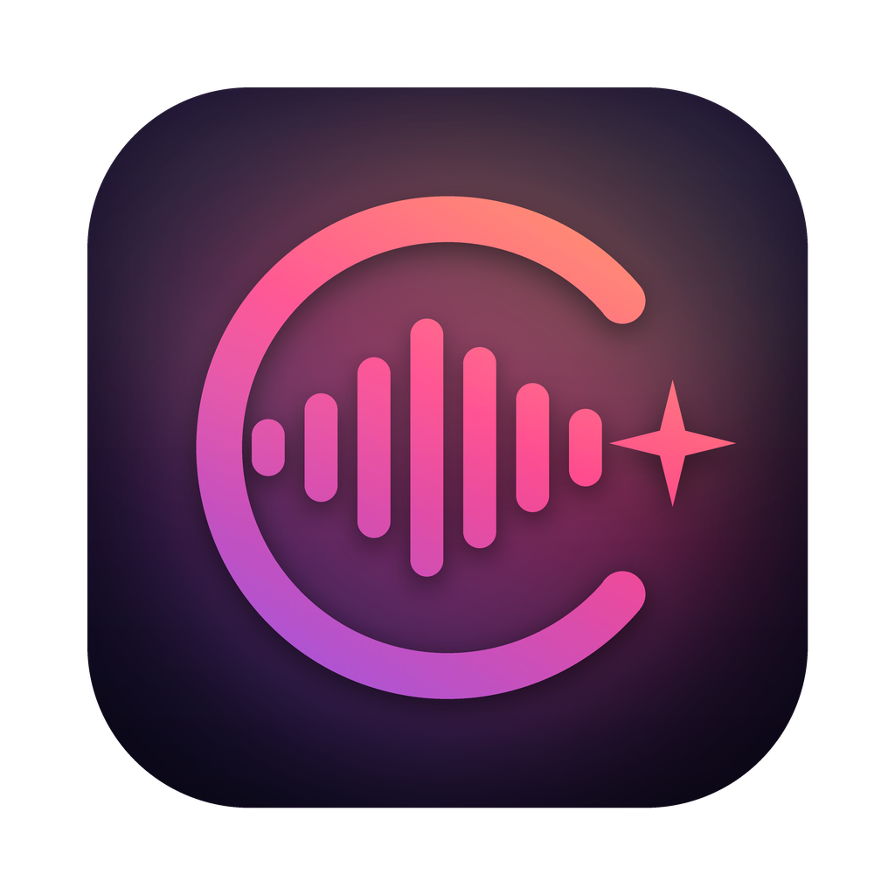
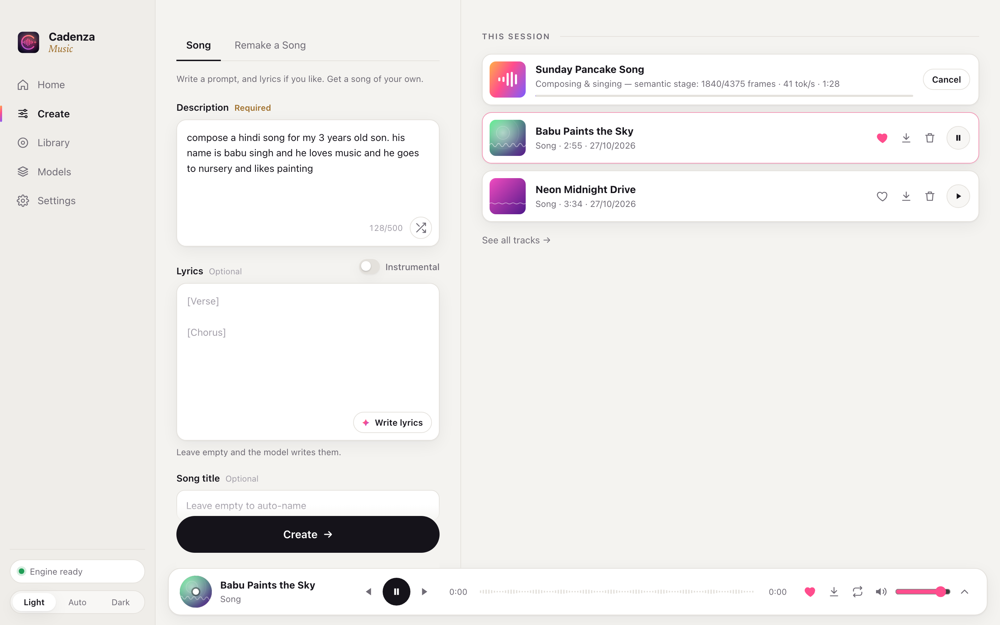
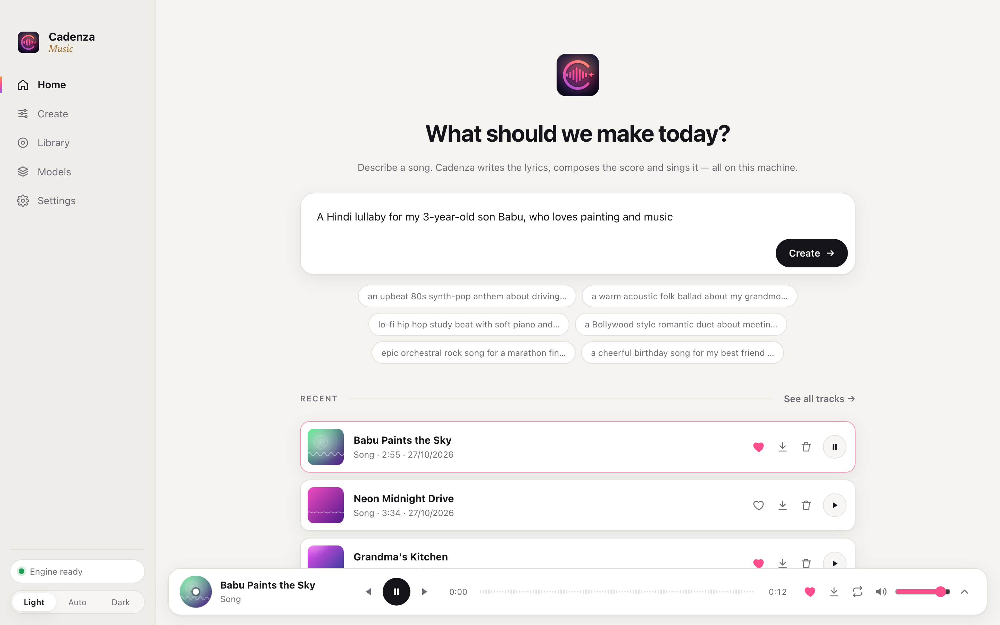
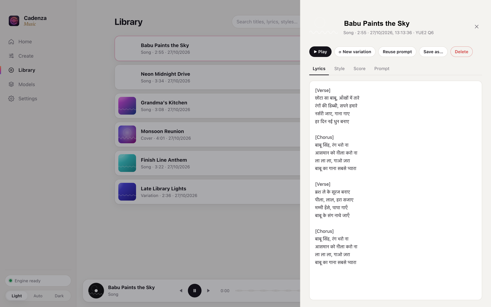
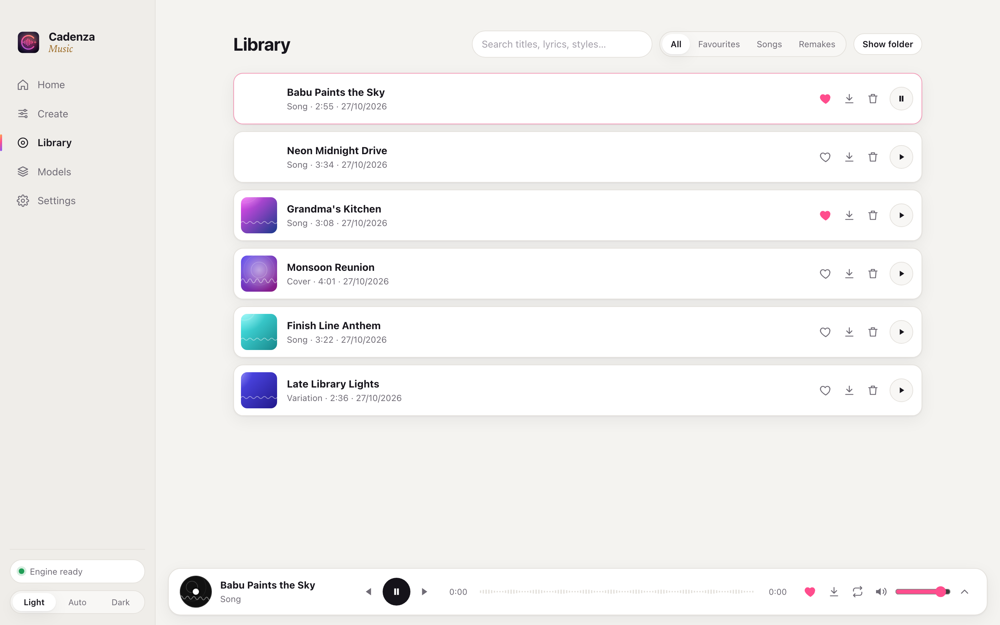
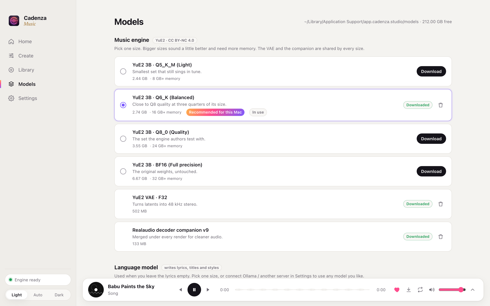
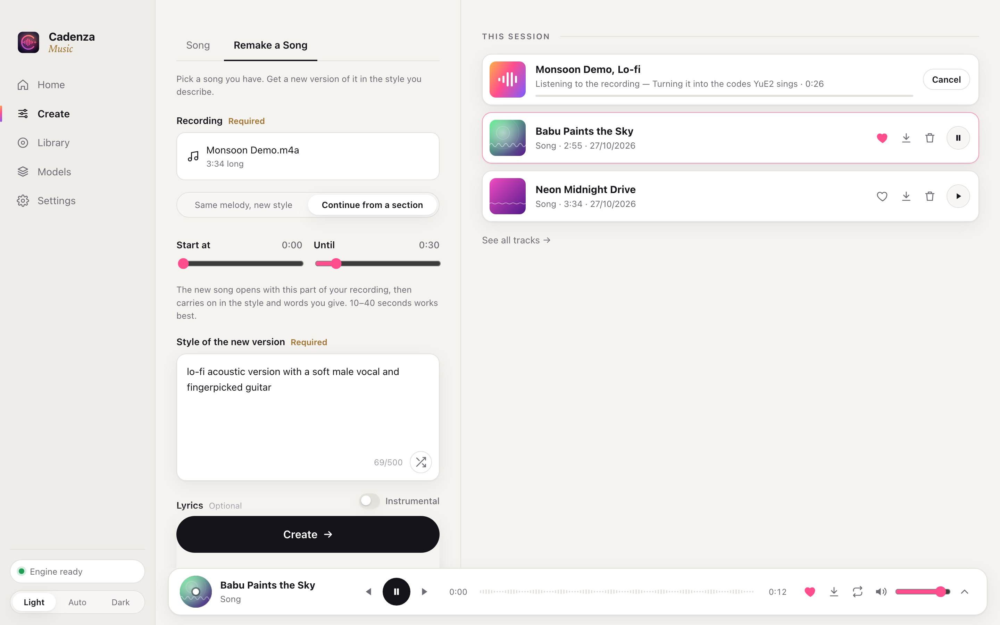
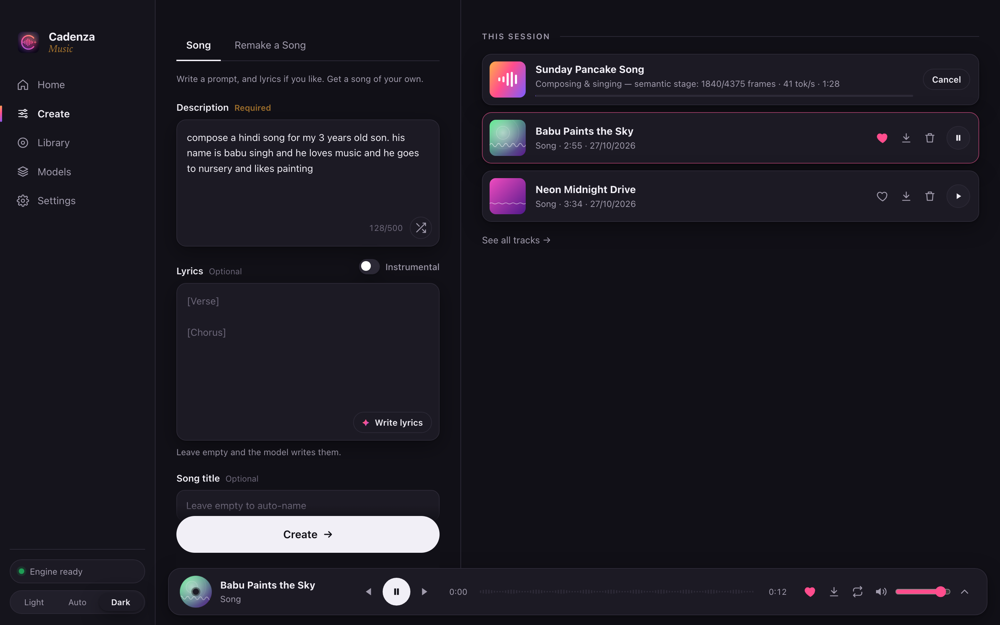
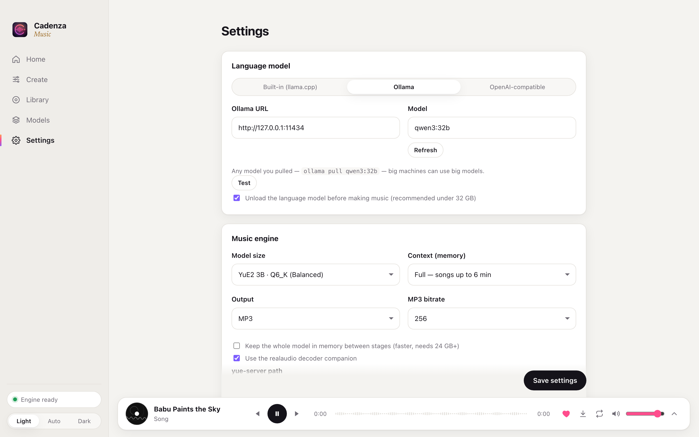

<div align="center">



# Cadenza

**Describe a song. Get a full song with vocals, made on your own machine.**

Rust + Tauri desktop app · YuE2 music model via yue2.cpp (Metal / Vulkan) · lyrics by a local LLM

[**Website**](https://cadenza.devops-monk.com) · [**Download**](https://github.com/devops-monk/cadenza/releases/latest)



</div>

Type *"a Hindi lullaby for my 3-year-old son Babu, who loves painting"* and press **Create**.
A local language model writes the lyrics, title and style. Then YuE2 composes a score with
melody and chords and performs it as a finished track with vocals. Nothing leaves the
computer, and you can make as many songs as you like.

## Features

- **Song**: a description is enough. Lyrics, the instrumental toggle, the title and every engine setting are optional.
- **✦ Write lyrics**: fills the lyrics, title and style from the description so you can edit them before making the song.
- **Remake a Song**: drop in an MP3, WAV, FLAC, M4A, OGG or AIFF and get a new version of it:
  - *Same melody, new style*: SheetSage2 transcribes the melody to a score and YuE2 sings it again in the style you describe.
  - *Continue from a section*: the realaudio tokenizer turns a section you pick into YuE2's codes, and the new song opens with it and carries on.
  - Lyrics are optional; the language model writes new ones when left empty.
- **Variations**: re-renders a finished song's composition with a new sound seed, without composing it again.
- **Library**: search, favourites, rename, Save as…, lyrics / style / score / prompt for every track, reuse a prompt.
- **Player**: waveform seek, previous / next, repeat, volume, favourite, save.
- **Models**: every size of every model, with resumable downloads, SHA-256 checks and recommendations based on your RAM.
- **Any language model**: built-in llama.cpp with Gemma 4 (E4B up to 12B Q8), Ollama, or any OpenAI-compatible server.
- **Light and dark themes.**

## Screenshots

| | |
|---|---|
|  |  |
| **Home**: type an idea and press Create | **Every song keeps its recipe**: lyrics, style, score, prompt |
|  |  |
| **Library**: search, favourites, Save as… | **Models**: every size, recommended for your machine |
|  |  |
| **Remake a Song**: a new version of any recording | **Create**: describe it and watch it being made |
|  |  |
| **Dark mode** | **Settings**: built-in model, Ollama or any server |

## Download

Grab the installer for your system from [Releases](https://github.com/devops-monk/cadenza/releases/latest):
`.dmg` for macOS (Apple Silicon), `-setup.exe` / `.msi` for Windows, `.AppImage` / `.deb` for Linux.
On macOS, if the app is reported as damaged (it isn't notarised yet), run `xattr -cr /Applications/Cadenza.app` once.

## Run it

Requirements: macOS 12+ on Apple Silicon (the GPU is used through Metal), Rust, CMake and git.
Linux with NVIDIA should work too (CUDA build). It is untested.

```bash
# 1. build the music engine (yue2.cpp → yue-server, Metal), about 5 minutes
./scripts/build-engine.sh

# 2. run the app in development…
cd src-tauri && cargo tauri dev
# …or build Cadenza.app / .dmg
cd src-tauri && cargo tauri build
```

On first start, open **Models** and download:

| What | Size | Why |
|---|---|---|
| YuE2 backbone (Q6_K recommended for 16 GB) | 2.9 GB | composes and sings |
| YuE2 VAE + companion | 0.67 GB | turns latents into audio |
| llama.cpp runtime + Gemma 4 E4B | ~5.2 GB | writes lyrics from your description |

Already have Ollama? Choose **Settings → Language model → Ollama** and pick any model you've pulled.
Then you can skip the Gemma download.

## Memory guide

| Memory | YuE2 | Language model |
|---|---|---|
| 8–16 GB | Q5_K_M / Q6_K | Gemma 4 E4B (unloaded before music) |
| 24 GB | Q8_0 | Gemma 4 12B q4_0 |
| 32 GB+ | BF16 | Gemma 4 12B Q5/Q6, or a large Ollama model |
| 64 GB+ | BF16, keep loaded | Gemma 4 12B Q8, or 30–70B models via Ollama |

## Layout

```
PLAN.md                 design and roadmap
ui/                     HTML/CSS/JS front end (no build step)
src-tauri/src/
  catalog.rs            every downloadable model, pinned + hashed
  downloads.rs          resumable downloads, SHA-256, tar.gz unpack
  engine.rs             yue-server supervisor, HTTP client, multipart results
  llm.rs                llama-server sidecar / Ollama / OpenAI-compatible
  songwriter.rs         description → {title, style, lyrics}
  jobs.rs               the generation pipeline
  library.rs            tracks on disk
scripts/build-engine.sh builds yue-server into src-tauri/resources/yue2-cpp
scripts/make-icon.py    renders assets/icon.png
```

## Licences and credits

- Cadenza is MIT licensed.
- **YuE2 weights are CC BY-NC 4.0.** Music made with them is for **non-commercial use only**.
- Engine: [yue2.cpp](https://github.com/ServeurpersoCom/yue2.cpp) by ServeurpersoCom, from the fork pinned by
  [YuE2 Studio](https://github.com/timoncool/YuE2-Studio). Weights: [M-A-P YuE2](https://map-yue2.github.io/), GGUF by Serveurperso.
  Decoder companion: Mothersuperior.
- Lyrics: Google Gemma 4 (Gemma Terms of Use) served by [llama.cpp](https://github.com/ggml-org/llama.cpp).
